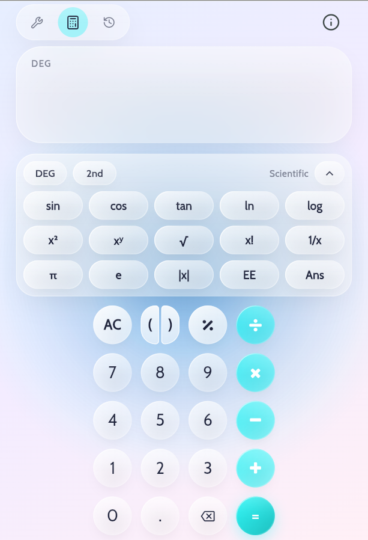
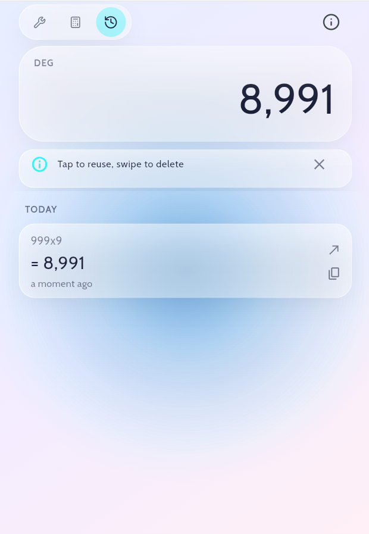
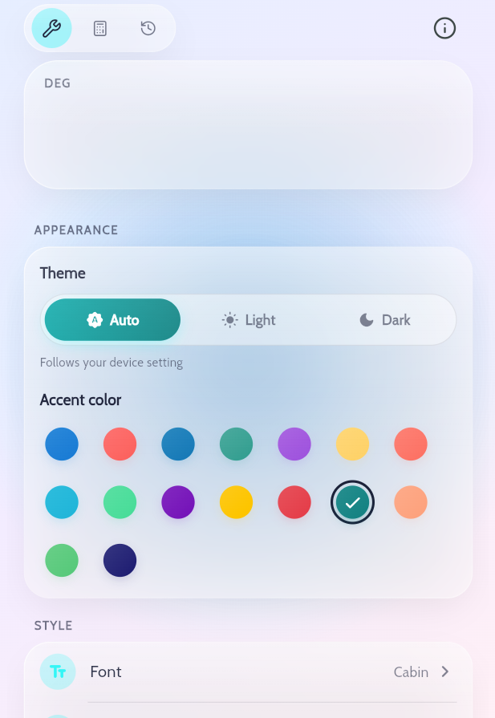

# Glass Calculator

A scientific calculator with a liquid glass design, built in Flutter.

Forked from [Neumorphic Calculator](https://github.com/mllrr96/Neumorphic-Calculator)
by Mohammed Ragheb (MIT). The original neumorphic look has been replaced and the
calculator extended.

## Screenshots

<table>
  <tr>
    <td></td>
    <td></td>
    <td></td>
  </tr>
  <tr>
    <td align="center">Calculator</td>
    <td align="center">History</td>
    <td align="center">Settings</td>
  </tr>
</table>

## Features

- **Liquid glass UI:** frosted panels, glass keys and a softly animated background,
  in light and dark.
- **Scientific mode:** sin, cos, tan and their inverses, ln, log, powers, roots,
  factorial, π, e, EE and Ans, with a DEG/RAD switch and a 2nd key.
- **Calculation history:** every calculation is recorded, grouped by day. Tap to
  reuse, use or copy a result, swipe to delete.
- **Themes:** Auto/Light/Dark and a choice of accent colors, fonts and button radius.

## Run it

```bash
git clone <this repository>
cd glass-calculator
flutter pub get
flutter run
```

Web works out of the box (`flutter run -d chrome`).

## Platform support

Android, iOS and web. A `windows/` folder is included, but building for Windows
needs a working Visual Studio C++ toolchain.

## License

MIT, see [LICENSE](LICENSE). The original copyright notice is kept.

## Acknowledgements

- [Neumorphic Calculator](https://github.com/mllrr96/Neumorphic-Calculator) by
  Mohammed Ragheb, the project this is forked from.
- Built with [Flutter](https://flutter.dev/).
